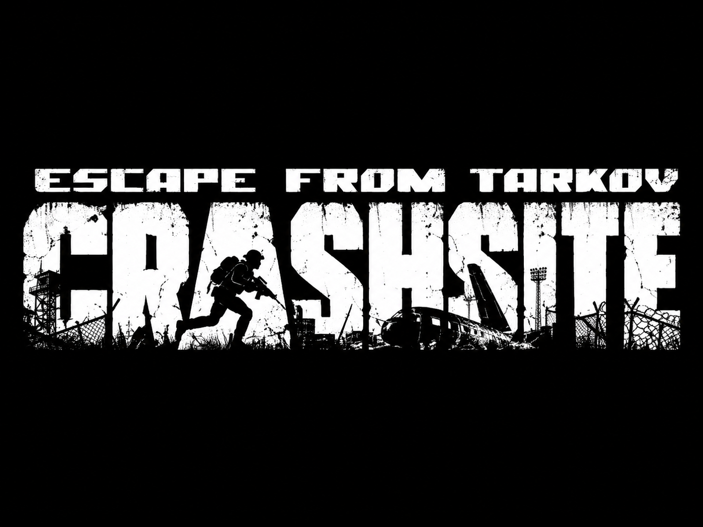

<div align="center">



A hardcore survival location for **SPT 4.1.6**, inspired by *The Division: Survival*.

Crashsite adds a separate, selectable raid into Customs: permanent night, abundant loot, all twelve bosses, and an incurable toxin that steadily damages you.

</div>

## Survive by any means necessary

- **PMC Level 21 required to infil.**
- **Always 01:00**.
- **All twelve regular bosses** and their escorts arrive by the eight-minute mark at max.
- **Dense loot and unlocked doors.** Loot is abundant and keys are not required.
- **Permanent toxin.** Healing and Immunity still help; antidotes do not.
- **No starting equipment.** You get your knife, a loaner M9 and your secure container. Good luck.

## Installation

Extract a matching [Release](https://github.com/Decade-GitHub/crashsite/releases) package into your SPT installation root. It contains:

```text
BepInEx/plugins/Crashsite.Client.dll
SPT_Runtime/user/mods/Crashsite/Crashsite.Server.dll
```
Fika is not currently supported.

## Building

Build on Windows with PowerShell, Visual Studio's Roslyn compiler, and an installed **SPT 4.1.6**. The server needs the .NET 10 and ASP.NET Core 10 shared runtimes required by SPT. The supplied scripts do not require a .NET SDK.

Set your SPT installation path and build both halves:

```powershell
$env:SPT_ROOT = 'C:\Games\SPT'
.\src\server\build.ps1 -Configuration Release
.\src\client\build.ps1 -Configuration Release
```

Use `-Configuration Debug` for diagnostic logging. Outputs are written to `src/server/bin/<Configuration>/net10.0/` and `src/client/bin/<Configuration>/`.

| Setting | Where | Value |
| --- | --- | --- |
| `SPT_ROOT` / `-SptRoot` | Environment / build and test scripts | Your SPT installation root. |
| `SptRuntimePath` | Server `.csproj` | Derived from `SPT_ROOT`; can be set explicitly to the installation's `SPT_Runtime` directory. |
| `CSC_PATH` / `-CscPath` | Environment / build and test scripts | Optional path to Roslyn's `csc.exe`. Otherwise the scripts check PATH and discover Visual Studio through `vswhere`. |
| `DOTNET_ROOT` / `-DotnetRoot` | Environment / server build and test scripts | Optional .NET installation root. Defaults to `Program Files\dotnet`. |

The client `.csproj` reads `SPT_ROOT` from the environment. Keep the existing frameworks, assembly names, reference filenames, and `CRASHSITE_DEBUG` configuration. Both `.csproj` versions, the client's `PluginVersion`, and the server's `CrashsiteClientHandshake.Version` must match; this release uses **1.0.0**.

Reference assemblies are read from your installation. Generated `bin/` and `obj/` files belong outside source control.
